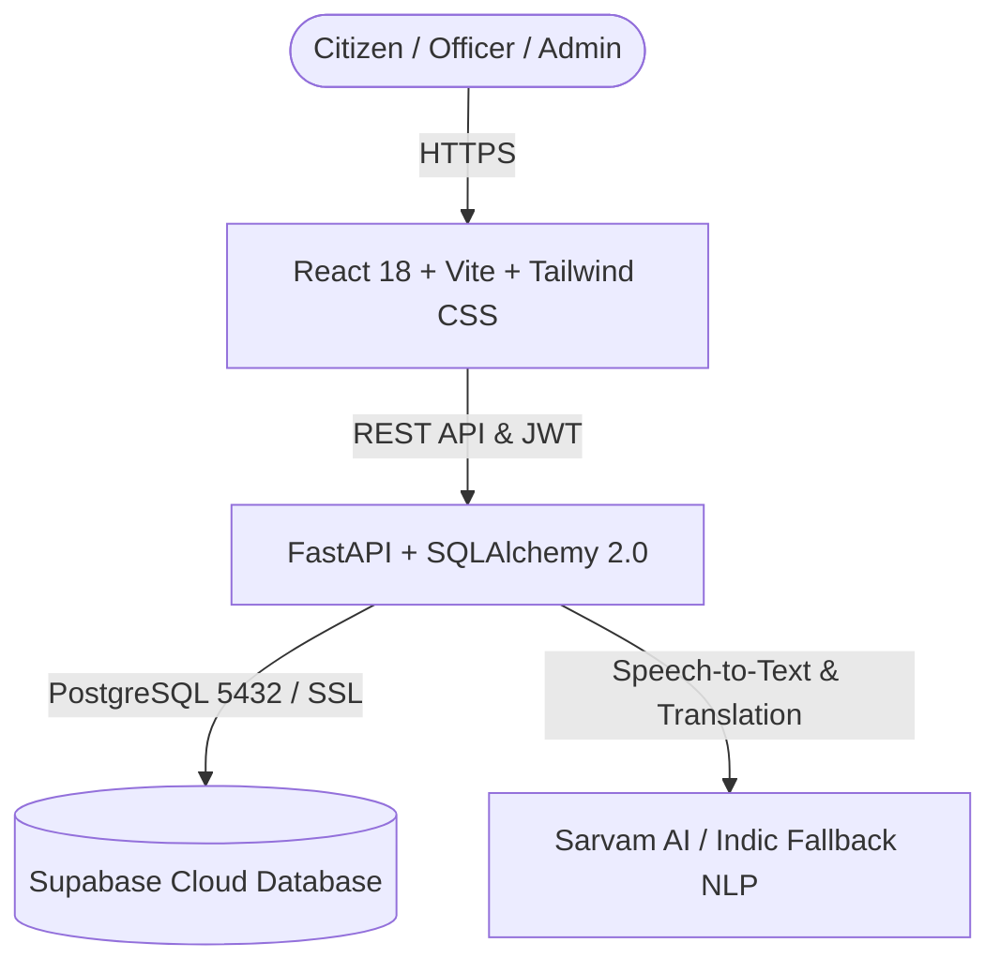

# 🏛️ JanSahayak AI (Team Neural-Storm)
### *AI-Powered Multilingual Public Grievance Redressal Platform*
> **"Your Language. Your Voice. Your Government."**

[](https://fastapi.tiangolo.com)
[](https://react.dev/)
[](https://www.typescriptlang.org/)
[](https://supabase.com)
[](https://tailwindcss.com/)

---

## 📌 Overview

**JanSahayak AI** bridges the communication divide between citizens and public administration across India. Citizens can report civic grievances in their native language (Hindi, Marathi, Tamil, etc.) through speech or text. The built-in AI pipeline transcribes voice notes, translates content, assesses urgency, automatically routes the complaint to the correct authority across 11 government departments with strict SLA countdowns, and provides public progress tracking without leaking citizen PII.

---

## ✨ Key Features

1. **🎙️ Multilingual Indic Voice & Speech Studio**:
   - Real-time microphone audio capture with Web Audio API equalizer volume meters.
   - Cross-browser support (Chrome, Brave, Firefox, Edge).
   - Audio playback review and speech-to-text transcription.

2. **🤖 Multi-Topic AI Grievance Routing**:
   - Automatic classification across **11 distinct Government Departments**:
     - *Department of Water Supply & Sewerage*
     - *Department of Energy & Power*
     - *Public Works Department (PWD)*
     - *Municipal Corporation & Sanitation*
     - *Department of Health & Family Welfare*
     - *Department of Transport*
     - *Department of School Education*
     - *Food & Civil Supplies Department (PDS)*
     - *Department of Police & Public Safety*
     - *Revenue & Land Administration*
     - *General Administration Department*
   - Urgency scoring with SLA deadline calculation (24h Critical, 48h High, 96h Medium, 168h Low).

3. **👥 4 Role-Based Administrative Portals**:
   - **Citizen**: File grievances, record audio, track tickets, submit feedback.
   - **Field Officer**: Update status, add progress notes, resolve tickets.
   - **Department Head**: Department SLA monitoring, overdue escalations.
   - **System Admin**: Cross-department analytics, audit logging, category mappings.

4. **🔍 Public Grievance Tracking**:
   - Citizens can track any ticket (e.g. `JSA-2026-MJJZLJ`) publicly with an anonymized timeline that protects citizen privacy.

---

## 🛠️ Tech Stack & Architecture



- **Frontend**: Vite 5, React 18, TypeScript, Tailwind CSS, Lucide Icons, Web Audio API.
- **Backend**: FastAPI, SQLAlchemy 2.0, Uvicorn, Pydantic v2.
- **Database**: Cloud Supabase PostgreSQL (15 relational schemas).

---

## 🚀 Step-by-Step Guide to Run the Project

### Prerequisites
Make sure you have the following installed on your machine:
* **Node.js** (v18.0 or higher) & **npm** $\rightarrow$ [Download Node.js](https://nodejs.org/)
* **Python** (v3.10 or higher) $\rightarrow$ [Download Python](https://www.python.org/)
* **Git** $\rightarrow$ [Download Git](https://git-scm.com/)

---

### Step 1: Clone the Repository
Open your terminal / PowerShell:
```bash
git clone https://github.com/Anushka-Nirmal/Neural-Storm.git
cd Neural-Storm
```

---

### Step 2: Set Up Environment Variables
Copy the sample environment files for both root and backend:

**On Windows (PowerShell):**
```powershell
Copy-Item .env.example .env
Copy-Item backend/.env.example backend/.env
```

**On macOS / Linux:**
```bash
cp .env.example .env
cp backend/.env.example backend/.env
```
> *(Optional: If you are connecting to your own database, update `DATABASE_URL` in `backend/.env`)*.

---

### Step 3: Run the Backend (Terminal 1)

Open your first terminal window in the project root:

**On Windows (PowerShell):**
```powershell
# 1. Install backend dependencies (if not already installed)
pip install -r backend/requirements.txt

# 2. Set Python path and start the FastAPI server
$env:PYTHONPATH="backend"
python -m uvicorn app.main:app --host 127.0.0.1 --port 8000 --reload
```

**On macOS / Linux:**
```bash
# 1. Install dependencies
pip install -r backend/requirements.txt

# 2. Start the FastAPI server
PYTHONPATH=backend python -m uvicorn app.main:app --host 127.0.0.1 --port 8000 --reload
```

✅ **Backend will be running at:**
- Health Check: [http://127.0.0.1:8000/health](http://127.0.0.1:8000/health)
- Interactive API Documentation (Swagger): [http://127.0.0.1:8000/docs](http://127.0.0.1:8000/docs)

---

### Step 4: Run the Frontend (Terminal 2)

Open a **second** terminal window and navigate to the `frontend` folder:

```bash
cd frontend

# 1. Install frontend packages (first time only)
npm install

# 2. Launch Vite development server
npm run dev
```

✅ **Frontend will be running at:**
- **[http://localhost:5173](http://localhost:5173)**

Open your web browser and navigate to `http://localhost:5173`!

---

## 🔑 Pre-Configured Demo Accounts for Testing

On the login page ([http://localhost:5173/login](http://localhost:5173/login)), you can **click any one-click demo login button** or enter these credentials manually:

| Role | Email | Password | What You Can Test |
| :--- | :--- | :--- | :--- |
| **Citizen** | `citizen@jansahayak.gov.in` | `CitizenPassword@2026` | Live voice recording studio, submit grievances, track your complaints |
| **Field Officer** | `officer.water@jansahayak.gov.in` | `StaffPassword@2026` | Department ticket workspace, update status, add resolution notes |
| **Department Head** | `head.water@jansahayak.gov.in` | `StaffPassword@2026` | Department SLA monitoring, escalate overdue tickets, view analytics |
| **System Admin** | `admin@jansahayak.gov.in` | `AdminPassword@2026` | Cross-department analytics, category-department mappings, audit logs |

---

## 🔍 Public Ticket Tracking

Citizens can track any grievance publicly without logging in:
1. Open **[http://localhost:5173/track](http://localhost:5173/track)**
2. Enter a ticket reference ID (e.g. `JSA-2026-MJJZLJ`)
3. View the live status progression timeline.

---

## 🧪 Running Automated Tests

Run backend unit tests (13 tests):
```bash
# Windows PowerShell:
$env:PYTHONPATH="backend"; python -m pytest backend/tests -v

# macOS / Linux:
PYTHONPATH=backend pytest backend/tests -v
```

Run frontend production build verification:
```bash
cd frontend
npm run build
```

---

## 📄 License
This project is developed for civic innovation and public benefit.
